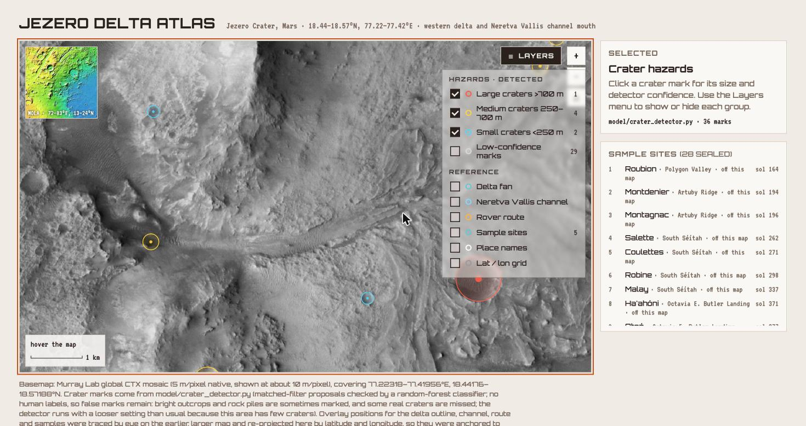

# Interplanetary Survival Guide: Martian Map — The Triumvirate

Our project for the **NASA Space Apps Challenge 2026**, challenge
[Interplanetary Survival Guide: Martian Map](https://www.spaceappschallenge.org/2026/challenges/interplanetary-survival-guide-martian-map/).

## What it does

A survival map for a crew on a Marswalk at the western delta of Jezero Crater. One mission, *Jezero Pathfinder*,
with two objectives: find evidence of ancient microbial life, and assess whether the site can sustain human life.

- **Layered atlas.** A real orbital image (CTX, about 10 m per pixel) with crater hazards found by our Python model,
  five mission stops with real Perseverance photos, and radiation, relief and texture layers. Those three science
  layers are computed from the orbital image, not measured, and the app labels them that way.
- **Safe route.** A planner finds a route through the stops that goes around the detected craters and rates each leg's risk.
- **Three screens.** An astronaut helmet display, an astronaut tablet, and an Earth mission-control page that share
  a room code, with chat and an SOS alert.
- **Daily planner.** Mission tasks, a to-do list and an automatic schedule, plus suit, health and team tabs
  (simulated values).

> **Note:** The crater detector has no human-checked labels. It can mark things that are not craters and miss real
> ones; low-confidence marks sit in their own layer. See `jezero-delta-atlas/README.md`.

## Quick start (nothing to install)

Open any of these in a browser (each is one self-contained file in `jezero-delta-atlas/dist/`):

| File | What it is |
|---|---|
| `jezero-delta-atlas.html` | The atlas: map, layers, mission, route planner, planner, suit, team |
| `astronaut-helmet.html` | Helmet display |
| `astronaut-tablet.html` | Tablet with the safe route |
| `earth-control.html` | Earth mission control (receives SOS and chat) |
| `simulation-control.html` | Operator page that drives the demo |

Create a room on one page; the others opened in the same browser join it.

## Slides

Our seven-slide presentation: [`docs/slides/jezero-delta-atlas-slides.pdf`](docs/slides/jezero-delta-atlas-slides.pdf).

## What's in this repo

| Folder / file | What it is |
|---|---|
| `jezero-delta-atlas/` | **The main project:** the map, the crater-detection model and its data. Has its own README with all the details. |
| `pages/mission-intro.html` | Intro page with the mission story and map. Its videos live in `pages/assets/`. |
| `docs/mission-guide.md` | The mission: 2 objectives, base camp, 5 stops and 10 tasks (source of `web/data/mission-data.js`). |
| `docs/to-do.md` | What the team still has to do. |

## Inside `jezero-delta-atlas/`

| Folder | What it is |
|---|---|
| `dist/` | The finished map as one single file. Open this one. |
| `web/` | The map's source: page (`html/`), styles (`css/`), code (`js/`), data, images. |
| `model/` | The crater-detection model (Python). |
| `integration/` | Scripts that download the Mars image and connect the model to the web page. |
| `craters.csv` | Table of every crater found (opens in Excel / Sheets). |

See [`jezero-delta-atlas/README.md`](jezero-delta-atlas/README.md) for how to re-run the model.

## Live demo

- Intro page: https://fattypp.github.io/Interplanetary-Survival-Guide-Martian-Map-of-The-Triumvirate/pages/mission-intro.html
- Atlas: https://fattypp.github.io/Interplanetary-Survival-Guide-Martian-Map-of-The-Triumvirate/jezero-delta-atlas/dist/jezero-delta-atlas.html

## Route planner

The atlas has a **Route planner** panel. Click *Pick start and destination*, then click two points on the map. It finds the fastest route that avoids the detected craters (A* search on a grid of about 17 m cells) and reports the distance in km or m and the travel time for the pressurised rover (2.8 m/s) or an astronaut on foot (1.4 m/s); the speeds come from `web/data/travel-speeds.js`. Craters with detector confidence 0.6 or higher are blocked; weaker marks only slow the route down. The code is in `jezero-delta-atlas/web/js/route-planner.js`. Slope, rocks and dunes are not modelled yet, because the repo has no elevation data fine enough for that.

## Team

The Triumvirate:

- Jayesh Araja
- Jose Perez-Carreño
- Juhyeok Ahn

## Use of AI tools

- **Code, documentation and slides:** parts of the code, the documentation and the presentation slides were written
  with the help of Claude (Anthropic), an AI assistant.
- **Videos:** the two intro videos in `pages/assets/` were generated with Canva AI. Each carries a visible
  "AI-generated video (Canva AI)" label and the same note in its file metadata.

## License and credits

Code is released under the [MIT License](LICENSE). Basemap imagery comes from the
Murray Lab CTX global mosaic and NASA MOLA data; the intro page uses
NASA Trek tiles. Those remain under their providers' terms. Credit NASA/JPL/Caltech/Murray Lab
when reusing them.
